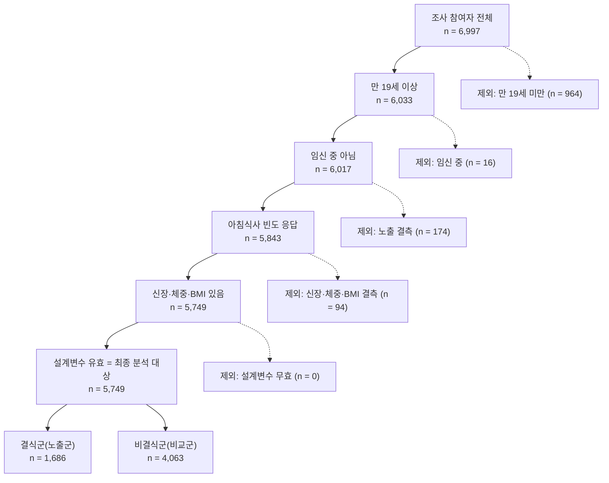

## B-1 흐름도

| 단계 | 기준 | 남은 n | 제외 n | 제외 이유 (구분) |
|---|---|---:|---:|---|
| 0 | 전체 조사 참여자 | 6,997 | - | 출발 대상 |
| 1 | 만 19세 이상 | 6,033 | 964 | 만 19세 미만, 연구 대상 아님 (비해당) |
| 2 | 임신 중 아님 (`HE_prg` ≠ 1) | 6,017 | 16 | 임신 중 (제외 기준) |
| 3 | 아침식사 빈도 응답 (`L_BR_FQ` 1-4) | 5,843 | 174 | 노출 정의 불가, `L_BR_FQ` 결측 (결측) |
| 4 | 신장·체중·BMI 결측 제외 (이상값 기준 적용 안 함) | 5,749 | 94 | 결과 정의 불가, 신장·체중·BMI 결측 (결측) |
| 5 | `wt_tot` > 0, `kstrata`·`psu` 유효 | 5,749 | 0 | 설계변수 무효 (설계상 제외) |
| 최종 | 최종 분석 대상 (`in_study = 1`) | 5,749 | | |
| | 결식군 (노출군) | 1,686 | | |
| | 비결식군 (비교군) | 4,063 | | |

- 9주차와의 차이: 없다. 0-5단계 인원이 9주차(6,997 / 6,033 / 6,017 / 5,843 / 5,749 / 5,749)와 모두 같다.
- 3단계 제외 174명: 9주차 연령대별 확인에서 `L_BR_FQ` 결측은 전체 192명이고 이 중 19세 미만이 18명이므로 성인은 174명이다. 이 결측은 `L_BR_FQ` 9(모름/무응답)가 아니라 값이 없는 경우이며, `L_BR_FQ` 9는 자료에 없었다. 9주차에 확인한 `wt_tot` 결측도 192명으로 인원이 같지만, 같은 사람인지는 이번 노트북에서 교차 확인하지 않았다.
- 4단계 제외 94명: BMI 이상값 기준은 적용하지 않았다(이용지침서에 신장·체중 이상값 제외 기준이 없고 팀도 정하지 않았다). 따라서 94명은 이상값이 아니라 결측으로 제외되었다. 3단계까지 통과한 5,843명 중 변수별 결측은 신장(`HE_ht`) 94명, 체중(`HE_wt`) 23명, BMI(`HE_BMI`) 94명이다. 체중 결측 23명은 신장 결측 94명에 포함된다. 9주차 정의표는 신장·체중의 측정 불능·미참여를 결측으로 처리한다고 적었다. 신장이 비어 있는 구체적 사유는 【이용지침서 검진조사 설명 ○쪽에서 확인. 확인하지 못하면 "자료에 사유가 기록되어 있지 않다"고 적는다】.
- 이상값 기준을 정하면 4단계 인원이 달라지므로 흐름도를 다시 계산한다.
- 분석 대상은 `in_study = 1`, 설계변수 유효 여부는 `design_ok`로 표시했고 행은 지우지 않았다. `design_ok`인 6,805명이 설계 자료이며 이 안에서 5,749명이 분석 도메인이다.

### 설계변수 점검

| 항목 | 값 |
|---|---|
| 설계 자료 (`design_ok`) | 6,805명 |
| 분석 대상 (도메인) | 5,749명 |
| 층 수 (`kstrata`) | 27 |
| 집락 수 (`psu`, 층+조사구) | 192 |
| 층당 집락 수 최소 | 2 (분산 추정에 필요한 2 이상 충족) |
| 설계 자료의 가중치 합 | 51,522,035명 |

`wt_tot`는 건강설문·검진·영양조사를 함께 쓸 때의 가중치이다. 노출(영양조사), 결과(검진), 공변량(건강설문)을 모두 쓰므로 이 분석에 맞다 (이용지침서 24쪽, 표 6-2 28쪽).

## B-2 Table 1 및 각주

| 변수                             | 구분        | 전체             | 결식군           | 비결식군         |
|:---------------------------------|:------------|:-----------------|:-----------------|:-----------------|
|                                  |             | n = 5,749        | n = 1,686        | n = 4,063        |
| 나이(세), 평균(SE)               |             | 49.9 (0.49)      | 39.4 (0.45)      | 55.4 (0.48)      |
| 결측 n                           |             | 0                | 0                | 0                |
| BMI(kg/m²), 평균(SE)             |             | 24.3 (0.07)      | 24.3 (0.12)      | 24.2 (0.08)      |
| 결측 n                           |             | 0                | 0                | 0                |
| 총에너지 섭취(kcal), 중앙값[IQR] |             | 1735 [1284–2293] | 1722 [1227–2310] | 1741 [1312–2284] |
| 결측 n                           |             | 2                | 0                | 2                |
| 성별                             |             |                  |                  |                  |
|                                  | 남자        | 2,474 (50.2)     | 739 (52.5)       | 1,735 (49.0)     |
|                                  | 여자        | 3,275 (49.8)     | 947 (47.5)       | 2,328 (51.0)     |
| 결측 n                           |             | 0                | 0                | 0                |
| 거주지역                         |             |                  |                  |                  |
|                                  | 동          | 4,595 (83.5)     | 1,465 (87.8)     | 3,130 (81.2)     |
|                                  | 읍·면       | 1,154 (16.5)     | 221 (12.2)       | 933 (18.8)       |
| 결측 n                           |             | 0                | 0                | 0                |
| 교육수준                         |             |                  |                  |                  |
|                                  | 초졸 이하   | 779 (9.4)        | 59 (2.0)         | 720 (13.4)       |
|                                  | 중졸        | 603 (8.4)        | 53 (2.4)         | 550 (11.6)       |
|                                  | 고졸        | 1,517 (25.6)     | 383 (21.3)       | 1,134 (27.9)     |
|                                  | 대졸 이상   | 2,702 (56.6)     | 1,162 (74.3)     | 1,540 (47.1)     |
| 결측 n                           |             | 148              | 29               | 119              |
| 현재흡연                         |             |                  |                  |                  |
|                                  | 아니오      | 4,847 (84.3)     | 1,331 (78.5)     | 3,516 (87.4)     |
|                                  | 예          | 761 (15.7)       | 327 (21.5)       | 434 (12.6)       |
| 결측 n                           |             | 141              | 28               | 113              |
| 월간음주                         |             |                  |                  |                  |
|                                  | 월 1회 미만 | 2,729 (43.8)     | 628 (34.7)       | 2,101 (48.8)     |
|                                  | 월 1회 이상 | 2,880 (56.2)     | 1,031 (65.3)     | 1,849 (51.2)     |
| 결측 n                           |             | 140              | 27               | 113              |
| 식사요법                         |             |                  |                  |                  |
|                                  | 예          | 1,862 (32.1)     | 506 (29.3)       | 1,356 (33.5)     |
|                                  | 아니오      | 3,885 (67.9)     | 1,180 (70.7)     | 2,705 (66.5)     |
| 결측 n                           |             | 2                | 0                | 2                |
| 비만(BMI 25 이상)                |             |                  |                  |                  |
|                                  | 아니오      | 3,650 (62.3)     | 1,050 (60.9)     | 2,600 (63.0)     |
|                                  | 예          | 2,099 (37.7)     | 636 (39.1)       | 1,463 (37.0)     |
| 결측 n                           |             | 0                | 0                | 0                |

### 각주
- **표기**: 열은 전체 / 결식군 / 비결식군 순이며, 열 머리의 n은 비가중 표본 수 입니다. 범주형 변수는 n (가중 %)로 제시하였습니다. n은 비가중 응답자 수이고, %는 각 열에서 해당 변수 값이 있는 대상자를 분모로 한 가중 백분율이며, 반올림으로 합이 100.0%와 다를 수 있습니다.
- **요약통계**: 나이와 BMI는 가중 평균(표준오차, SE)으로, 총에너지 섭취는 분포가 오른쪽으로 치우쳐 가중 중앙값 [제1사분위수–제3사분위수]로 제시하였고, 가중 분위수는 누적 가중치를 기준으로 산출하였고 중앙값에는 SE를 제시하지 않았다. 나이는 만 80세 이상이 80으로 코딩되어 있어 평균 나이가 다소 낮게 나타날 수 있습니다.
- **표본설계**: 모든 추정에 가중치 `wt_tot`, 층 `kstrata`, 집락 `psu`를 적용하였습니다(이용지침서 93·94쪽, 가중치 선택 24쪽·표 6-2 28쪽, 복합표본 분석 35쪽). 집락은 층 안의 조사구(`psu`)로 구분하였고 모든 층에 집락이 2개 이상 있어 분산 추정이 가능하였습니다. 표준오차는 Taylor 선형화로 추정하였고, 설계 정보가 유효한 6,805명을 모두 유지한 채 분석 대상 5,749명을 도메인(하위모집단)으로 지정하여 추정하였습니다.
- **분석 대상과 정의**: 분석 대상은 만 19세 이상 성인 중 임신 중이 아니며 아침식사 빈도와 신장·체중·BMI가 유효한 5,749명입니다. 결식군은 아침식사 빈도(`L_BR_FQ`, 이용지침서 218쪽) 주 1-2회·거의 안 먹음, 비결식군은 주 5-7회·주 3-4회로 정의하였고, 비만은 BMI 25 kg/m² 이상(`HE_obe` 4-6, 이용지침서 179쪽)으로 정의하였습니다.
- **결측·무응답**: 공변량 결측은 제외하지 않고 변수별 '결측 n'으로 표시하였으며 %의 분모에서는 제외하였습니다. 교육수준 99(모름·무응답)와 식사요법 9는 결측으로 처리하였고, 원자료에서 이미 결측인 값도 결측 n에 포함하였습니다. 교육수준은 원코드 1-3을 초졸 이하, 4를 중졸, 5를 고졸, 6-8을 대졸 이상으로 묶었습니다(`09_protocol.md` 정의표와 동일).
- **자료**: 질병관리청 국민건강영양조사 제9기(2022–2024) 중 2024년 자료를 사용하였습니다.

### 해석 주의
Table 1의 비만 비율과 공변량 분포 차이는 기술통계이며, 연령·생활습관 차이가 교란변수인지는 11주차 DAG에서 판단하고, 아침식사 빈도별 비만 비율은 예상과 다르더라도 결과 그대로 제시합니다.

## B-3. 비가중 대 가중 비교

### 1. 비교 개요

| 항목 | 내용 |
|---|---|
| 분석 대상 | 5,749명 (만 19세 이상, 임신 제외, 아침식사 빈도 및 신장·체중·BMI 유효, 설계변수 유효) |
| 변수 정의 | B-2 Table 1과 동일 |
| 비가중 표 | 가중치·층·집락을 적용하지 않은 표본 수, 비율, 평균(SD), 중앙값[IQR] |
| 가중 표 | B-2 Table 1 (`wt_tot`, `kstrata`, `psu` 적용, 도메인 분석) |
| 결측 처리 | 공변량 결측은 제외하지 않고, 해당 변수에서 값이 있는 대상자 기준으로 비율 산출 |
| 비교 기준 | 상대차이(%) = \|가중 − 비가중\| / 비가중 × 100 |
| 보조 지표 | 절대 차이(%p) (기준 비율이 작은 범주는 상대차이가 크게 나올 수 있어 함께 제시) |
| 변수 선정 | 같은 변수의 여러 범주는 하나로 보고, 상대차이가 가장 큰 범주를 변수의 대표로 선택 |

### 2. 비가중 Table 1

| 변수                             | 구분        | 전체             | 결식군           | 비결식군         |
|:---------------------------------|:------------|:-----------------|:-----------------|:-----------------|
|                                  |             | n = 5,749        | n = 1,686        | n = 4,063        |
| 나이(세), 평균(SD)               |             | 53.9 (17.10)     | 41.5 (14.19)     | 59.1 (15.46)     |
| 결측 n                           |             | 0                | 0                | 0                |
| BMI(kg/m²), 평균(SD)             |             | 24.1 (3.86)      | 24.1 (4.22)      | 24.1 (3.70)      |
| 결측 n                           |             | 0                | 0                | 0                |
| 총에너지 섭취(kcal), 중앙값[IQR] |             | 1669 [1247–2191] | 1637 [1196–2207] | 1681 [1264–2189] |
| 결측 n                           |             | 2                | 0                | 2                |
| 성별                             |             |                  |                  |                  |
|                                  | 남자        | 2,474 (43.0)     | 739 (43.8)       | 1,735 (42.7)     |
|                                  | 여자        | 3,275 (57.0)     | 947 (56.2)       | 2,328 (57.3)     |
| 결측 n                           |             | 0                | 0                | 0                |
| 거주지역                         |             |                  |                  |                  |
|                                  | 동          | 4,595 (79.9)     | 1,465 (86.9)     | 3,130 (77.0)     |
|                                  | 읍·면       | 1,154 (20.1)     | 221 (13.1)       | 933 (23.0)       |
| 결측 n                           |             | 0                | 0                | 0                |
| 교육수준                         |             |                  |                  |                  |
|                                  | 초졸 이하   | 779 (13.9)       | 59 (3.6)         | 720 (18.3)       |
|                                  | 중졸        | 603 (10.8)       | 53 (3.2)         | 550 (13.9)       |
|                                  | 고졸        | 1,517 (27.1)     | 383 (23.1)       | 1,134 (28.8)     |
|                                  | 대졸 이상   | 2,702 (48.2)     | 1,162 (70.1)     | 1,540 (39.0)     |
| 결측 n                           |             | 148              | 29               | 119              |
| 현재흡연                         |             |                  |                  |                  |
|                                  | 아니오      | 4,847 (86.4)     | 1,331 (80.3)     | 3,516 (89.0)     |
|                                  | 예          | 761 (13.6)       | 327 (19.7)       | 434 (11.0)       |
| 결측 n                           |             | 141              | 28               | 113              |
| 월간음주                         |             |                  |                  |                  |
|                                  | 월 1회 미만 | 2,729 (48.7)     | 628 (37.9)       | 2,101 (53.2)     |
|                                  | 월 1회 이상 | 2,880 (51.3)     | 1,031 (62.1)     | 1,849 (46.8)     |
| 결측 n                           |             | 140              | 27               | 113              |
| 식사요법                         |             |                  |                  |                  |
|                                  | 예          | 1,862 (32.4)     | 506 (30.0)       | 1,356 (33.4)     |
|                                  | 아니오      | 3,885 (67.6)     | 1,180 (70.0)     | 2,705 (66.6)     |
| 결측 n                           |             | 2                | 0                | 2                |
| 비만(BMI 25 이상)                |             |                  |                  |                  |
|                                  | 아니오      | 3,650 (63.5)     | 1,050 (62.3)     | 2,600 (64.0)     |
|                                  | 예          | 2,099 (36.5)     | 636 (37.7)       | 1,463 (36.0)     |
| 결측 n                           |             | 0                | 0                | 0                |

*n (%)는 가중치를 적용하지 않은 표본 수와 비율(해당 변수 값이 있는 대상자 기준)이다. 연속형은 비가중 평균(표준편차, SD) 또는 중앙값[IQR]이다. 대상, 변수 정의, 결측 처리는 B-2 Table 1(가중)과 같다.*

### 3. 비가중 대 가중 비교 (전체 대상, 상대차이 내림차순)

비율은 %, 연속형은 평균이다.

| 항목 | 비가중 | 가중 | 차이(가중−비가중) | 상대차이(%) |
|---|---:|---:|---:|---:|
| 교육수준: 초졸 이하 | 13.91 | 9.37 | −4.54 | 32.62 |
| 교육수준: 중졸 | 10.77 | 8.39 | −2.38 | 22.10 |
| 아침 결식: 결식 | 29.33 | 34.85 | +5.52 | 18.83 |
| 거주지역: 읍·면 | 20.07 | 16.48 | −3.59 | 17.89 |
| 교육수준: 대졸 이상 | 48.24 | 56.64 | +8.40 | 17.42 |
| 성별: 남자 | 43.03 | 50.24 | +7.21 | 16.75 |
| 현재흡연: 예 | 13.57 | 15.74 | +2.17 | 16.01 |
| 성별: 여자 | 56.97 | 49.76 | −7.21 | 12.65 |
| 월간음주: 월 1회 미만 | 48.65 | 43.84 | −4.81 | 9.89 |
| 월간음주: 월 1회 이상 | 51.35 | 56.16 | +4.81 | 9.37 |
| 나이(세), 평균 | 53.91 | 49.86 | −4.05 | 7.52 |
| 교육수준: 고졸 | 27.08 | 25.60 | −1.49 | 5.49 |
| 거주지역: 동 | 79.93 | 83.52 | +3.59 | 4.49 |
| 비만(BMI 25 이상): 예 | 36.51 | 37.71 | +1.20 | 3.29 |
| 현재흡연: 아니오 | 86.43 | 84.26 | −2.17 | 2.51 |
| 비만(BMI 25 이상): 아니오 | 63.49 | 62.29 | −1.20 | 1.89 |
| 식사요법: 예 | 32.40 | 32.08 | −0.32 | 0.99 |
| BMI(kg/m²), 평균 | 24.13 | 24.26 | +0.13 | 0.53 |
| 식사요법: 아니오 | 67.60 | 67.92 | +0.32 | 0.47 |

### 4. 차이가 큰 변수 3개

| 순위 | 변수 (대표 범주) | 비가중 | 가중 | 차이(%p) | 상대차이(%) |
|---|---|---:|---:|---:|---:|
| 1 | 교육수준: 초졸 이하 | 13.91 | 9.37 | −4.54 | 32.62 |
| 2 | 아침 결식: 결식 | 29.33 | 34.85 | +5.52 | 18.83 |
| 3 | 거주지역: 읍·면 | 20.07 | 16.48 | −3.59 | 17.89 |

### 5. 결과 요약

- 비가중 표본에서는 초졸 이하, 읍·면 거주, 여자, 고령 대상자의 비율이 가중 추정보다 높았다. 가중을 적용하면 이 비율들은 낮아지고 남자와 상대적으로 젊은 연령층의 비중이 커졌다(나이 평균 53.9세 → 49.9세).
  - 초졸 이하: 고령층에 몰려 있는 집단이라 고령 참여자가 많은 비가중 표본에서 과대 반영되었고, 사후층화(시도·성별·연령별 인구수에 맞춤)로 연령 비중이 조정되면서 가중 비율이 낮아졌다.
  - 읍·면 거주: 동·읍면은 표본 추출틀의 층화 기준이며, 읍·면 층이 모집단 비중보다 많이 추출되어 과대 반영되었고, 설계가중치(추출률의 역수)가 이를 낮췄다.
- 노출 변수인 아침 결식 비율은 비가중 29.3%에서 가중 34.9%로 5.5%p 높아졌다. 비가중 표를 그대로 해석하면 아침 결식 비율을 모집단보다 낮게 보게 된다. 이는 결식이 상대적으로 젊은 연령층에서 높은 행태인데, 젊은 층이 적게 포함된 비가중 표본에서는 과소 반영되고 사후층화에서 젊은 연령층의 가중치가 커지기 때문이다.
- 결식군과 비결식군의 비만 비율은 비가중 37.7%와 36.0%, 가중 39.1%와 37.0%로, 어느 쪽에서도 결식군이 약간 높았다. 비만 비율(36.5% → 37.7%), BMI 평균(24.1 → 24.3), 식사요법은 가중 여부에 따른 차이가 작았다(상대차이 3.3% 이하).
- 이는 기술통계 수준의 비교이며, 차이가 생긴 구체적 원인이나 연령·생활습관 등 공변량의 영향은 11주차 DAG에서 판단한다.

### 6. 비가중 표가 모집단을 반영하지 못하는 이유

가중치는 표본설계 시점과 조사 시점 간 포함오차, 불균등 추출률, 조사 미참여자의 무응답오차 등을 보정하며(이용지침서 23쪽), 설계가중치(추출률의 역수), 무응답 조정, 사후층화 과정을 거쳐 산출된다(25쪽). 또한 표본은 2단계 층화집락표본으로 추출되었으므로 분석에 복합표본 요소를 반영해야 한다(35쪽). 따라서 가중치를 적용하지 않은 표는 모집단의 분포를 반영하지 못한다.

차이가 큰 세 변수는 가중치 구성요소와 다음과 같이 연결해 해석할 수 있다.

- 교육수준 초졸 이하(비가중 13.91% → 가중 9.37%): 사후층화는 시도·성별·연령 기준이며 교육수준을 직접 맞추지는 않는다. 다만 초졸 이하는 고령층에 집중된 집단이고, 참여자 중 고령층 비중이 높아(2024년 60대 18.3%, 70세 이상 19.1%, 지침서 표 5-2) 비가중 표본에서 과대 반영된다. 사후층화로 연령별 비중이 모집단에 맞춰지면 이 집단의 가중치가 낮아지며, 평균 연령이 53.9세에서 49.9세로 내려간 것과 같은 방향이다.
- 아침 결식(비가중 29.33% → 가중 34.85%): 결식 역시 사후층화 기준이 아니며, 상대적으로 젊은 연령층에서 높은 변수이므로 연령 구성의 변화를 통해 간접적으로 영향을 받는 것으로 해석된다. 비가중 표본에서는 젊은 층이 적게 포함되어 있다가, 사후층화에서 젊은 연령층의 가중치가 커지면 결식 비율도 함께 높아진다.
- 거주지역 읍·면(비가중 20.07% → 가중 16.48%): 동·읍면은 표본 추출틀의 층화 기준이다(3쪽). 읍·면 층에 배정된 조사구 비중은 연 192개 중 38개(약 20%)로(표 2), 가중 추정치(16.5%)보다 높다. 읍·면 층이 모집단 비중보다 많이 추출된 것으로 해석되며, 설계가중치(추출률의 역수)가 이를 낮춰 준다.
- 
*자료: 국민건강영양조사 제9기(2022-2024) 중 2024년*

## 역할분담 (10주차 B-1, B-2, B-3)

| 과제 | 세부 업무 | 산출물 | 담당 |
|---|---|---|---|
| **B-1 흐름도** | 행을 지우지 않고 `in_study`, `design_ok` 표시변수로 단계별 인원·제외 인원·사유 정리 (6,997명 → 5,749명) | 흐름도 표(노트북 3절), 문서 B-1 절 | 한은서 |
| | BMI 관련 94명의 제외 사유 확인 (신장·BMI 결측 94명, 체중 결측 23명) | 제외 사유 설명 문장 | 한은서 |
| **B-2 Table 1** | 열 구성(전체 / 결식군 / 비결식군, 열 머리에 비가중 n)과 행 구성(정의표의 공변량 전체 + 비만, BMI 가중 평균) | 가중 Table 1(노트북 6절) | 홍수미 |
| | 설계변수(`wt_tot`, `kstrata`, `psu`) 적합성 확인, 설계 기반 SE·도메인 분석, 범주 비율 합 100% 확인 | 설계변수 점검(4절), 6절 assert | 홍수미 |
| | 교육수준 묶음(`edu4`)을 이용지침서 134쪽 코드와 09_protocol.md 정의표에 대조 | 확정된 묶음 기준 | 홍수미 |
| **B-2 각주** | n·% 의미, 요약통계 근거, 가중치·층·집락과 도메인 분석, 결측·무응답·비해당 처리, 자료명·연도 | 각주 문단(문서·노트북) | 홍수미 |
| **B-3 비가중 대 가중** | 같은 대상·같은 정의로 비가중 Table 1 작성 | 비가중 Table 1(7절 앞 새 셀) | 이예림 |
| | 가중 대 비가중 비교, 차이가 큰 변수 3개 선정(비교 기준 명시) | 비교표, 상위 3개 표 | 이예림 |
| | 비가중 표가 모집단을 반영하지 못하는 이유 설명(이용지침서 쪽 번호 포함) | 설명 문단 | 이예림 |

## AI 사용내역

10주차 B-1~B-3 과제에서 Claude(Anthropic)를 사용하였다.
Claude는 노트북 코드의 초안을 작성하였다.
Claude는 원자료로 코드를 실행하지 않았으며, 제안받은 코드는 팀원이 Colab에서 직접 실행하였다. 문서에 쓴 모든 수치는 실행 결과에서 옮긴 값이고, 실행 결과와 문서의 숫자가 일치하는지 직접 대조하였다. 이용지침서 쪽 번호와 교육수준 묶음(`edu4`)이 이용지침서 코드 및 정의표(09_protocol.md)와 맞는지는 팀이 직접 확인하였다. 차이의 원인이나 교란 여부에 대한 해석은 기술통계 수준으로 제한하고 11주차 DAG에서 판단하기로 하였다.
AI가 작성한 초안은 팀이 검토하고 수정하였으며, 제출한 코드와 수치, 해석에 대한 책임은 팀에 있다.
