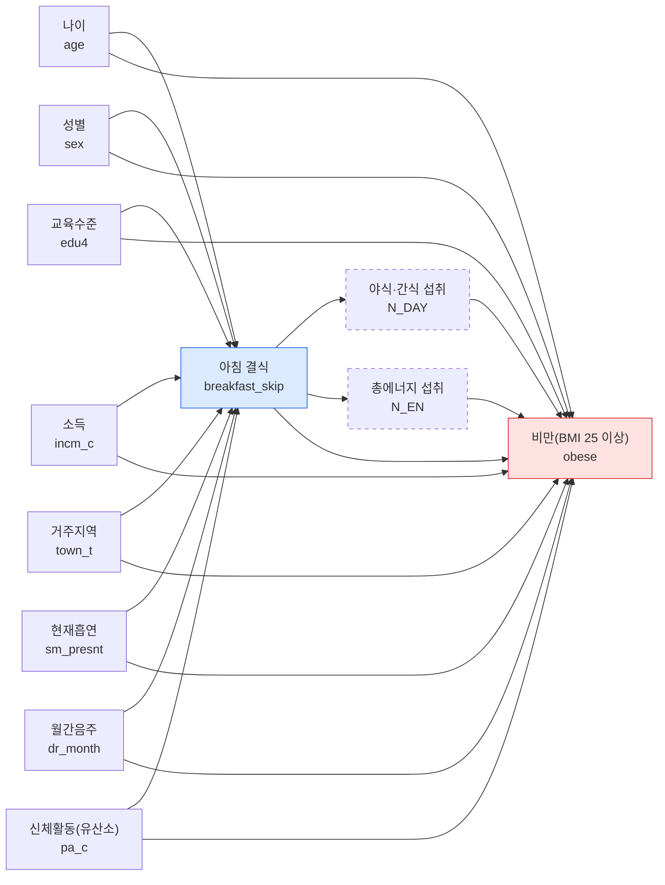

## C-1. DAG와 보정집합

### DAG

점선 테두리는 매개 후보입니다. 체중 조절 노력은 비만의 결과일 수 있어(역방향) 정의표에 없는 변수라 그림에 넣지 않고 C-3 한계에 적었습니다.

### 역할 표

| 변수 | 변수명 | 역할 | 보정 | 근거(시간 순서) |
|:--|:--|:--|:--|:--|
| 나이 | `age` | 교란 | O | 나이는 식습관과 체중보다 먼저 정해진다. |
| 성별 | `sex` | 교란 | O | 성별은 태어날 때 정해지며 식습관과 체중에 모두 영향을 준다. |
| 교육수준 | `edu4` | 교란 | O | 교육은 성인기 식습관과 체중 상태보다 먼저 이루어진다. |
| 소득 | `incm_c` | 교란 | O | 소득은 식사 여건과 식품 선택을 통해 식습관과 체중에 영향을 준다. |
| 거주지역 | `town_t` | 교란 | O | 거주지는 식품 접근성과 생활 환경을 통해 식습관과 체중에 영향을 준다. |
| 현재흡연 | `sm_presnt` | 교란 | O | 흡연은 식욕과 생활 리듬과 관련된다. |
| 월간음주 | `dr_month` | 교란 | O | 음주는 다음 날 식사와 섭취 열량에 영향을 줄 수 있다. |
| 신체활동(유산소) | `pa_c` | 교란 | O | 정의표: 식습관과 체중 모두에 영향을 주는 공통 원인으로 간주. |
| 야식·간식 섭취 | `N_DAY` | 매개 | X | 아침 결식 후 허기로 야식·간식이 늘고, 이것이 섭취 열량을 통해 체중에 영향을 준다. |
| 총에너지 섭취 | `N_EN` | 매개 | X | 아침 결식 후 하루 총 섭취 열량이 달라지고, 이것이 체중에 영향을 준다. |

충돌부로 본 변수는 없습니다.

### 화살표별 근거

| 화살표 | 근거(시간 순서) |
|:--|:--|
| 나이 → 아침 결식 | 나이는 식습관보다 먼저 정해지며 연령대마다 아침 식사 습관이 다르다 |
| 나이 → 비만 | 나이는 체중 상태보다 먼저 정해지며 연령에 따라 비만 비율이 다르다 |
| 성별 → 아침 결식 | 성별은 태어날 때 정해지며 식사 습관이 성별로 다를 수 있다 |
| 성별 → 비만 | 성별은 태어날 때 정해지며 체지방과 비만 비율이 성별로 다르다 |
| 교육수준 → 아침 결식 | 교육은 성인기 식습관 형성보다 먼저 이루어지며 식사 시간·선택에 영향을 줄 수 있다 |
| 교육수준 → 비만 | 교육은 체중 상태보다 먼저 이루어지며 건강 지식과 생활 습관에 영향을 줄 수 있다 |
| 소득 → 아침 결식 | 소득은 식사에 쓸 시간과 비용 등 식사 여건에 영향을 줄 수 있다 |
| 소득 → 비만 | 소득은 식품 선택과 생활 환경을 통해 체중에 영향을 줄 수 있다 |
| 거주지역 → 아침 결식 | 거주지(동/읍·면)는 식품 접근성과 생활 리듬에 영향을 줄 수 있다 |
| 거주지역 → 비만 | 거주지는 식품·운동 환경을 통해 체중에 영향을 줄 수 있다 |
| 현재흡연 → 아침 결식 | 흡연은 식욕과 생활 리듬에 영향을 줄 수 있다(한 시점 자료라 시간 순서 불확실) |
| 현재흡연 → 비만 | 흡연은 식욕과 대사를 통해 체중에 영향을 줄 수 있다(시간 순서 불확실) |
| 월간음주 → 아침 결식 | 음주는 다음 날 아침 식사에 영향을 줄 수 있다(시간 순서 불확실) |
| 월간음주 → 비만 | 음주는 섭취 열량을 통해 체중에 영향을 줄 수 있다 |
| 신체활동 → 아침 결식 | 신체활동은 식습관과 함께 형성되는 생활 습관이다(정의표: 식습관·체중 모두에 영향을 주는 공통 원인) |
| 신체활동 → 비만 | 신체활동은 에너지 소비를 통해 체중에 영향을 준다 |
| 아침 결식 → 야식·간식 섭취 | 아침 결식 이후 허기로 야식·간식이 늘 수 있다 |
| 야식·간식 섭취 → 비만 | 야식·간식은 섭취 열량을 늘려 체중에 영향을 준다 |
| 아침 결식 → 총에너지 섭취 | 아침 결식 이후 하루 총 섭취 열량이 달라질 수 있다 |
| 총에너지 섭취 → 비만 | 섭취 열량은 체중에 영향을 준다 |
| 아침 결식 → 비만 | 추정 대상: 아침 결식이 비만에 미치는 총효과 |

### 보정집합

- 추정 대상: 총효과 (아침 결식이 비만에 미치는 전체 효과)
- 최소 보정집합: 나이, 성별, 교육수준, 소득, 거주지역, 현재흡연, 월간음주, 신체활동(유산소) (교란변수 8개)
- 보정하지 않은 변수: 야식·간식 섭취, 총에너지 섭취(매개). 매개를 보정하면 총효과의 일부를 지우게 된다. 충돌부로 본 변수는 없어 충돌부 보정 문제는 없다.
- 확인: 노트북에서 노출에서 나가는 화살표를 지운 뒤 이 8개로 노출과 결과가 분리되는지(후문 기준) 검사해 모든 후문 경로가 막힘을 확인했다. 또 8개 중 하나라도 빼면 막지 못해 최소 보정집합이다.

## C-2. Table 2: 무보정·보정 회귀

**Table 2.** 아침 결식과 비만(BMI 25 이상)의 관련성: 복합표본 로지스틱 회귀, 오즈비(95% 신뢰구간)

| 노출 | 모형 1 OR | 95% CI | p | 모형 2 OR | 95% CI | p | 모형 3 OR | 95% CI | p |
|:--|--:|:--|--:|--:|:--|--:|--:|:--|--:|
| 아침 식사 (기준) | 1.00 | | | 1.00 | | | 1.00 | | |
| 아침 결식 | 1.11 | 0.98–1.26 | 0.091 | 1.16 | 0.99–1.35 | 0.058 | 1.17 | 1.01–1.36 | 0.040 |
| 분석 인원 n | 5,272 | | | 5,272 | | | 5,272 | | |
| Table 1 대비 제외 n | 477 | | | 477 | | | 477 | | |
| 보정변수 | 없음 | | | 8개 | | | 7개(신체활동 제외) | | |

**각주.** OR = 오즈비, CI = 신뢰구간. 기준 범주는 아침 식사이며, 아침 결식은 10주차 정의(L_BR_FQ 3·4)를 따랐다.

가중치 `wt_tot`, 층 `kstrata`, 집락 `psu`(층+조사구)를 적용한 복합표본 로지스틱 회귀이며, 표준오차는 Taylor 선형화로 추정하고 95% 신뢰구간과 p값은 자유도 165(집락 수 − 층 수)의 t분포로 구하였다. 분석 대상(Table 1의 5,749명)은 자료를 삭제하지 않고 도메인으로 지정하였다.

결과는 비만(BMI 25 이상, HE_obe 4~6)이다. 모형 1은 무보정, 모형 2는 DAG로 정한 총효과 보정집합(나이, 성별, 교육수준, 소득, 거주지역, 현재흡연, 월간음주, 신체활동(유산소)), 모형 3은 모형 2에서 신체활동만 뺀 모형이다. 에너지 섭취와 야식·간식은 매개 후보라, 체중 조절 노력은 역방향 가능성이 있어 보정하지 않았다.

보정변수가 모두 있는 5,272명(완전 사례)으로 세 모형을 같은 사람에게 적합하였으며 Table 1 분석 대상보다 477명(8.3%) 적다(보정변수 결측, 결측 값은 대체하지 않음).

비만 유병률이 높아(가중 37.9%) 오즈비가 위험을 실제보다 크게 보일 수 있다(유병률비는 12주차).

자료: 국민건강영양조사 제9기(2022-2024) 중 2024년.

## C-3. 결과 해석

### 결과

- 보정 후(모형 2), 아침 결식군은 아침 식사군보다 비만(BMI 25 이상)일 오즈가 1.16배(95% CI 0.99–1.35, p = 0.058)였다. 점추정치는 결식군에서 비만 오즈가 높은 방향이지만 신뢰구간이 1을 포함해, 이 자료에서는 뚜렷한 관련성을 확인하지 못했다.
- 오즈비 해석 주의: 완전 사례의 가중 비만 유병률이 37.9%로 흔하므로 오즈비는 유병률비보다 1에서 멀어 보여 위험의 차이를 실제보다 크게 보여 줄 수 있다. 유병률비는 12주차에 구한다.
- 선행연구와 비교: 이 결과(OR 1.16)는 횡단 연구 메타분석의 OR 1.48(Ma 2020)보다 작고 종단 연구의 RR 1.13(Wicherski 2021)과 비슷한 크기이다. 다만 노출 정의와 보정변수가 달라 직접 비교는 어렵다.

### 보정 전후

- 무보정(모형 1) OR 1.11(95% CI 0.98–1.26)에서 보정(모형 2) 1.16(95% CI 0.99–1.35)로 +4.5% 변해 거의 변하지 않았다. 방향은 1에서 조금 멀어졌다.
- DAG와 연결: 모형 2의 보정변수는 모두 결식과 비만의 공통 원인이다. 공통 원인을 보정하기 전에는 이 변수들이 관련성을 가려(과소 추정) 있었을 수 있으나, 변화가 작아 교란의 크기가 작았거나 변수들의 영향이 서로 상쇄되었을 수 있다. 어느 변수가 이 변화를 만들었는지는 이 노트북에서 나누어 보지 않았으므로 단정하지 않는다. 10주차 Table 1에서 결식군이 더 젊었던 점(나이)이 이 방향과 맞을 수 있으나 확인한 것은 아니다.
- 신체활동을 뺀 모형 3의 OR은 1.17(95% CI 1.01–1.36)로 모형 2(1.16)와 0.01 차이이다. 신체활동을 넣고 빼도 점추정치가 거의 같아, 신체활동이 매개 경로를 크게 지우고 있다는 증거는 이 자료에서 뚜렷하지 않다. 모형 3은 신뢰구간 하한이 1에 아주 가까워(1.01) 모형 2(0.99)와 유의 여부가 갈리지만, 이는 추정 정밀도의 작은 차이이므로 결론을 바꾸지 않는다.
- 에너지 섭취와 야식·간식은 매개로 보아 넣지 않았으므로, 모형 2는 결식이 이 경로를 거쳐 만드는 부분까지 포함한 총효과를 본다.

### 한계

- 한 시점 자료라 아침 결식과 비만의 시간 순서를 알 수 없고, 비만이 식습관 변화(체중 조절 노력 등)의 원인일 수 있는 역방향 인과를 배제할 수 없다.
- 체중 조절 노력, 유전·가족력 등 측정되지 않은 교란이 남아 있을 수 있다. 식사의 질, 수면, 근무 형태, 스트레스도 이 분석에 없다.
- 아침 식사 빈도는 자기 기입 자료이며 결식의 기준(주 1~2회 이하, 최근 1년 거의 안 함)에 따른 분류 오차가 있을 수 있다.
- 보정변수가 모두 있는 5,272명만 분석해 결측으로 477명(8.3%)이 빠졌고, 결측이 무작위가 아니면 결과가 달라질 수 있다. 신체활동 결측이 408명으로 가장 많다.
- 비만 유병률이 37.9%로 높아 오즈비가 위험을 실제보다 크게 보일 수 있다.
- 비만을 BMI 25 이상의 이분형으로 보아 BMI의 연속적 차이는 보지 못한다.

### 12주차 계획

1. **체중 조절 중인 사람을 뺀 민감도분석** (역방향 인과 확인): 최근 1년간 체중을 줄이려고 노력한 사람 등 체중 조절 중인 사람을 뺀 완전 사례로 모형 2를 다시 적합해 OR을 비교한다. 제외 기준 변수는 이용지침서의 `BO2_1`(1년간 체중 조절 여부, 140쪽)을 후보로 하며, 제외 규모는 12주차에 확인한다. 체중 조절 중인 사람을 빼도 OR이 비슷하면 역방향 인과의 영향이 작다는 쪽이지만, 확정할 수는 없다.
2. **역할이 애매한 변수를 넣고 빼는 비교와 직접효과 모형**: 신체활동·흡연·음주를 넣고 빼는 비교, 에너지 섭취를 추가한 직접효과 모형을 본다. 결측 처리 방법을 바꾼 분석과 오즈비 대신 유병률비를 구하는 모형도 함께 다룬다.

## 역할 분담

| 담당자 | 맡은 부분 |
|---|---|
| 홍수미 | C-1 DAG와 역할 표, dagitty.net 확인 |
| 홍수미 | C-1 역할 표와 보정집합 |
| 이예림 | C-2 회귀 |
| 이예림 | C-2 노트북(Table 2)과 각주 |
| 한은서 | C-3 결과 해석 |
| 한은서 | 역할 분담, AI 사용 내역 정리 |

## AI 사용 내역

- Claude (Anthropic):  DAG 초안, 노트북 코드 초안, 문서 뼈대 작성 보조. Claude는 원시자료를 볼 수 없었고 코드를 직접 실행하지 않았다. 코드는 팀원이 Colab에서 처음부터 실행했고 문서의 모든 숫자는 그 출력값이다. 변수의 역할과 보정집합은 팀이 직접 정했다.
